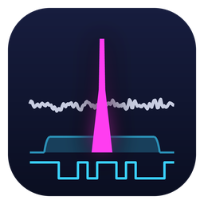
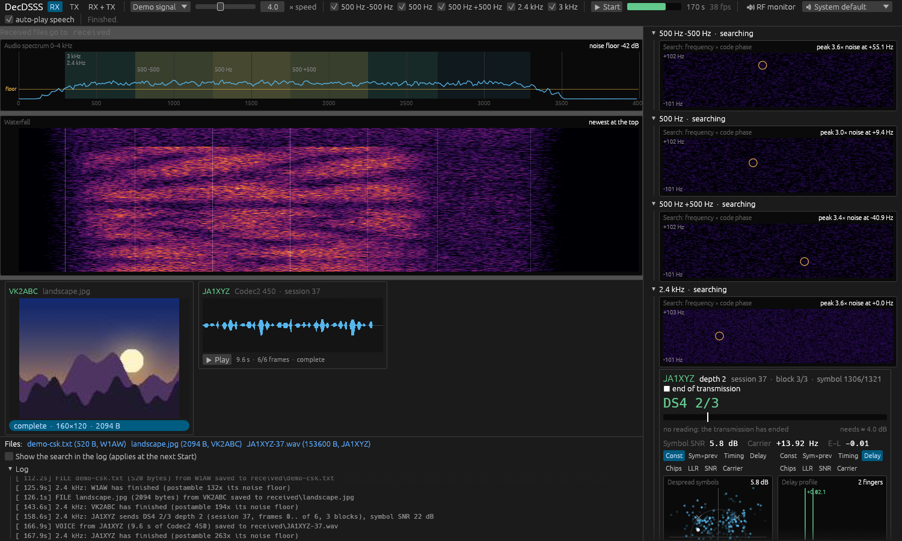

<!-- made by CasualArclamp -->
<p align="center"></p>

# DecDSSS

A narrowband spread-spectrum modem for amateur radio. It uses direct-sequence
(DS-PSK) and code-shift-keyed (CSK) spreading inside an SSB voice channel of
**500 Hz, 2.4 kHz or 3 kHz**, and carries files, pictures, Codec2 speech and text (CQ packets and chat). A signal can sit 15 dB under the noise in its own bandwidth and still
decode.

The receiver shows what it is doing, in the style of DecSAT's DVB-CID card:

- the acquisition search surface (code phase × frequency) and the preamble;
- the despread constellation and symbol × previous symbol (DS-PSK), or the
  Walsh correlator bank (CSK);
- early/prompt/late timing, the delay profile with the rake fingers on HF
  multipath, and the chip scope;
- symbol SNR and carrier strips, the soft bits of the last codeword, and which
  frames of a file are in;
- the audio spectrum and waterfall with the three profiles marked, so you can see
  the spread signal sitting under the noise floor;
- pictures, drawn as they arrive: a progressive JPEG shows the whole picture
  early and sharpens it as more of the file comes in;
- speech, as a waveform with the frames that have not come shaded, and a Play
  button; record into the Transmit window from any input device.



*Three stations on one 2.4 kHz channel, on different spreading codes (VK2ABC DS8
sending a picture, W1AW CSK64 sending a file, JA1XYZ DS4 sending speech), through
moderate HF fading with a 14 Hz carrier offset: the demo signal, at its end, with
the picture and the speech received.*

## How it works

| | 500 Hz | 2.4 kHz | 3 kHz |
|---|---|---|---|
| Chip rate | 400 /s | 1920 /s | 2400 /s |
| Occupies (audio) | 1250–1750 Hz | 300–2700 Hz | 300–3300 Hz |
| Information rate | 5.5 – 131 bit/s | 26 – 630 bit/s | 33 – 788 bit/s |

Chips are root-raised-cosine shaped (α = 0.25) and scrambled with a Gold code:
a shared *call code* for the preamble and header, then each station's *own code*
(from its callsign) for the data, so several stations on one frequency decode
side by side. Two ways of spreading, as a ladder of modes (`decdsss modes`):

- **DS-PSK**: a QPSK symbol held for SF chips (4 … 64), coherent, with a known
  pilot every eighth symbol and maximal-ratio rake combining.
- **CSK**: one of L orthogonal Walsh codes (32 … 256) per symbol, noncoherent,
  rake-combined on power: the robust end.

LDPC (rate ½, ⅔ or ¾, 1152-bit codewords, designed in this repository) and a
time interleaver sit under both. The 500 Hz profile has three slots, 500 Hz apart
(−500, middle, +500), so up to three 500 Hz stations share one 2.4 kHz channel; the
receiver listens on all three. A file is sent as frames in segments, each a
preamble, a rate-¼ header (callsign, mode, frame numbers) and blocks; a long
transmission repeats the preamble so a late listener can join, and the last
block is followed by a one-second end-of-transmission postamble that a receiver
following the station recognises, so it knows the station has finished. Frames are
erasure-coded: any as many frames as the file has data frames rebuild it, however
they were lost, and each repeat pass sends new coded frames.

[`docs/DESIGN.md`](docs/DESIGN.md) has the air interface, the receiver as built,
and every measurement. In short, on AWGN through the whole receiver every mode
from DS4 to CSK256 delivers all its frames at about 4 dB Eb/N0, which is an
in-band SNR from −0.8 dB (DS4 ¾) down to −15.6 dB (DS64 ½); moderate and poor
Watterson fading deliver every frame from 9–13 dB Eb/N0 (measured for DS8 and
CSK64 on 2.4 kHz).

## Use

```bash
# The mode ladder with rates and the SNR each needs
cargo run --release -p decdsss-cli -- modes --profile 2k4

# A file to audio, through the HF channel simulator, and back
cargo run --release -p decdsss-cli -- tx data.bin --call VK2ABC --mode ds8-1/2 --parity 25 -o tx.wav
cargo run --release -p decdsss-cli -- channel tx.wav noisy.wav --snr -4 --fading moderate --offset 12 --clock-ppm 25
cargo run --release -p decdsss-cli -- rx noisy.wav --out-dir received

# Sound cards (a virtual audio cable makes a silent test loop)
cargo run --release -p decdsss-cli -- devices
cargo run --release -p decdsss-cli -- rx --device "CABLE-A Output" --out-dir received
cargo run --release -p decdsss-cli -- tx data.bin --call VK2ABC --play "CABLE-A Input"

# A picture: scaled and compressed to fit 120 s of signal a pass, as a progressive JPEG
cargo run --release -p decdsss-cli -- tx photo.png --call VK2ABC --mode ds8-1/2 --picture --air 120 -o pic.wav
# rx saves the picture when it is whole, or a partial PNG of what came if it is not

# Speech: a WAV, as Codec2 450 (2k4) or 700C (3k), in the profile's voice mode
cargo run --release -p decdsss-cli -- tx speech.wav --call VK2ABC --profile 2k4 --voice -o voice.wav
# rx writes CALL-SESSION.wav (8 kHz speech), or a -partial.wav if frames are missing
# CQ: a header-only packet carrying the callsign, two copies; rx prints "CQ from ..."
cargo run --release -p decdsss-cli -- tx --cq --call VK2ABC -o cq.wav
# Waterfall ID: ahead of the signal, the callsign and mode written on the spectrum
cargo run --release -p decdsss-cli -- tx --cq --call VK2ABC --wfid -o cq.wav
# Text: a message (up to 1000 bytes); rx prints it and adds it to messages.log
cargo run --release -p decdsss-cli -- tx --text "Hello, 73" --call VK2ABC --profile 500 --slot +500 -o chat.wav

# Measure a mode: frame loss against Eb/N0 through the whole receiver
cargo run --release -p decdsss-cli -- sweep --mode csk64-1/2 --ebn0 2 6 1 --fading moderate --trials 16

# The window; the demo needs no radio
cargo run --release -p decdsss-gui -- --demo
cargo run --release -p decdsss-gui -- --device "CABLE-A Output"
# The same demo signal as a WAV (three stations on one channel), for --wav or the cli's rx
cargo run --release -p decdsss-gui -- --write-demo demo.wav

# Single-file Windows executables (static C runtime, nothing to install) into exe\
powershell -ExecutionPolicy Bypass -File scripts\build-portable.ps1
```

DecDSSS never keys a transmitter: it plays audio and you do the rest. Spread
spectrum is restricted below VHF in some countries (for example, US Part 97 allows
it only on 222 MHz and up): check your own licence conditions.

Licence: GPL-3.0-or-later.
